# Charte graphique d'Amertüme Online

Ce document fixe l'apparence du site. Toute nouvelle interface s'y conforme. Avant d'écrire une bulle, un bouton, un cartouche ou un texte, on relit la section qui le concerne et on **réutilise le composant existant**, jamais un style refait à la main.

Les images ci-dessous sont des captures du site lui-même.

---

## 0. Règles d'or

1. **Aucun texte non demandé.** On n'ajoute ni titre, ni aide, ni explication que Valentin n'a pas demandés. Un mot ajouté par prudence est une faute.
2. **On réutilise, on n'invente pas.** Une infobulle est une bulle de talent, un bouton est un bouton du site, un cartouche est un cartouche du site. Un nouveau style n'est créé que sur demande.
3. **Rien de ce qui existe n'est cassé ni retiré.** Un changement ajoute ou corrige, il ne supprime pas en passant.
4. **Les couleurs viennent de la charte.** Fonds, lignes et encres passent par les variables `--…` de la section 1. Les teintes de jeu (types de talent, états, caracs, extensions) viennent de leurs tables. Aucune couleur en dur hors de ces listes.
5. **Le français du site.** Guillemets « », espace insécable avant `: ; ! ?`, majuscule aux noms propres et aux noms de jeu (Gardé, Foudre, Plasma, Incident). Pas d'anglais.
6. **En cas de doute, on demande** avant de coder.

---

## 1. Couleurs de base

Tout le décor passe par ces variables (`index.html`, `:root`). Le thème sombre a les mêmes noms avec d'autres valeurs : on n'écrit donc jamais la couleur elle-même.

| Variable | Clair | Rôle |
|---|---|---|
| `--bg` | `#e9e3d5` | fond de page |
| `--panel` | `#f8f4e9` | panneaux, fenêtres, bulles simples |
| `--panel-2` | `#eee7d6` | fond secondaire, bandeaux |
| `--field` | `#fffdf5` | champs de saisie |
| `--btn` | `#f0e9d8` | bouton ordinaire |
| `--hover` | `#dfd5bd` | survol d'un bouton |
| `--line` | `#cfc1a6` | bordures fines |
| `--line-strong` | `#b0a084` | bordures marquées, fenêtres |
| `--ink` | `#241d16` | texte |
| `--muted` | `#6c6254` | texte secondaire, titres de section |
| `--accent` | `#9c631c` | bouton principal, focus, mot clé du MJ sans couleur |
| `--green` | `#3d7a5b` | « à moi », sélection, validé |
| `--red-mat` | `#a4442f` | danger matériel |

Pour éclaircir ou foncer une teinte, on la mélange avec `color-mix(in srgb, teinte x %, #fff)` ou `#000` : ce sont les deux seules couleurs neutres permises en dur.

---

## 2. Typographie

| Usage | Police | Exemple |
|---|---|---|
| Texte courant, boutons, champs | `system-ui`, 16 px | les phrases des bulles |
| Titres de bulle, noms d'aventurier, chiffres des caracs, titres de fenêtre | **Killam** gras (`'Killam',Georgia,serif`) | « Gardien », « Éla », « 3 » |
| Titres de section et de colonne | `system-ui` 600, 12 px, MAJUSCULES, espacement 2,5 px, encre `--muted` | « ESPÈCES », « COMPÉTENCES » |
| Cartouche de classe | `system-ui` 700, 11 px, MAJUSCULES, espacement 2 px | « GARDIENNE niv. 3 » |

Les chiffres, `xdy` et `%` d'un texte de jeu sont en **gras** (section 4).

---

## 3. Infobulle

**Il n'y a qu'un modèle d'infobulle : celui des talents.** Toute bulle du site (talent, objet, extension, dé de Plasma, aide…) le reprend.

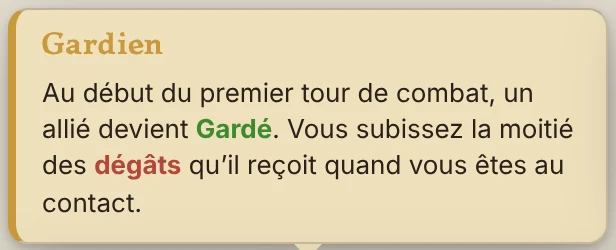

**Anatomie**
- Un conteneur `.bulle.bulle-talent`, ouvert par `surveille(ancre, () => ouvrirBulle(ancre, contenu, 'bulle-talent'))`. Il apparaît au survol, se place au-dessus ou dessous, avec sa petite flèche.
- Un contenu `.talent-detail.large`, sur un fond pâle de sa teinte, avec un **liseré de 4 px à gauche** dans la teinte pleine.
- Un titre `p.talent-bulle-nom > b`, en **Killam gras**, à la couleur de la teinte.
- Le texte, en `p.palier-effet`, écrit avec `texteEnrichi()` pour colorer les mots clés.
- Une ligne d'Incident, si besoin, en `p.palier-effet.talent-incident` (section 4).

**Teinte par type** (classe `t-…` du contenu)

| Type | Classe | Teinte | Fond |
|---|---|---|---|
| Maîtrise | `t-mait` | `#c99a3c` | `#f0e0bd` |
| Action | `t-act` | `#4f7fb5` | `#cfdcea` |
| Action bonus | `t-abon` | `#2a9d8f` | `#cdeae6` |
| Mouvement | `t-mvt` | `#8a6440` | `#eee2d4` |
| Réaction | `t-reac` | `#8b6bb5` | `#ddd3ea` |
| Passif | `t-pass` | `#8a8474` | `#dcd8cf` |
| Critique | `t-crit` | `#b5525a` | `#eccfd0` |
| Amélioration | `t-ame` | `#5e9a5b` | `#d3e5cd` |

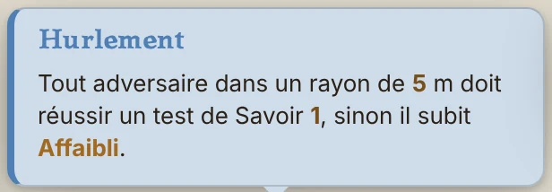 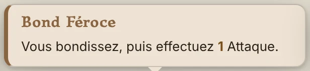
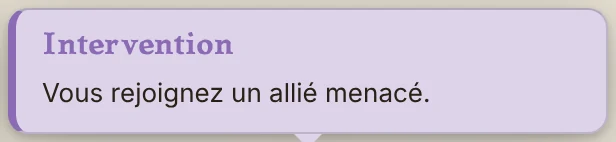 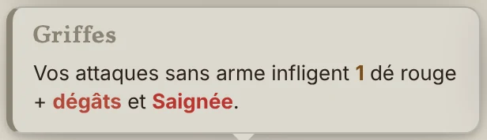 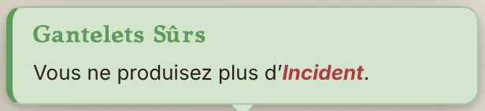

**Bulle hors talent.** On garde le même contenu `.talent-detail.large` et on donne sa teinte par `--teinte` : fond à 14 % de la teinte sur `#fbf3e2`, liseré et titre dans la teinte. Exemple, l'Extension :

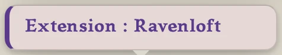

**Toujours un fond.** Toute bulle a le fond pâle de sa teinte et son liseré : un talent par sa classe `t-…`, un objet par sa rareté, tout le reste par `.bulle-teintee` et sa `--teinte` (ou une classe dédiée comme `bulle-extension`). Un `.talent-detail` sans teinte ne s'ouvre jamais.

**Interdit** : une bulle en simple texte, un fond blanc ou gris sans liseré, un `title=` du navigateur à la place d'une bulle.

---

## 4. Mots clés colorés

**Homogénéité** : dans une même barre, bulle, cartouche ou ligne, tous les chiffres et tous les textes de même rôle ont la même police, la même taille et la même graisse. Seule la couleur les distingue. Un chiffre ajouté à un élément reprend toujours la police de ses voisins (ex. : la valeur de Radiance reprend celle des PV de sa barre).

Dans tout texte de jeu (bulles, fiches, journal), les mots clés se colorent et se graissent d'eux-mêmes par `texteEnrichi()`. On n'écrit jamais la couleur à la main dans un texte.

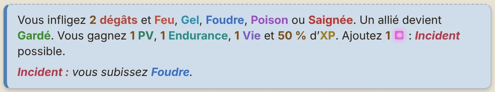

| Mot clé | Couleur | Style |
|---|---|---|
| Chiffres, `xdy`, `%` | noir `#000` | **gras** |
| Action bonus | `#2a9d8f` | gras |
| PA | `#4f7fb5` | gras |
| PM | `#8a6440` | gras |
| Compétences (Agilité, Ruse…) | teinte de l'icône de la compétence, `SKILL_TINTS` | gras |

**Token d'espèce** (`.creation-token-espece`) : à la création, rond dans le coin bas droit de la fiche de l'espèce, liseré de sa teinte, ombre `#0003`. Dans les Tokens, ★ le désigne, doré `#f2c14e` une fois choisi.

**Valeur de Radiance** (`.pv-rad-val`) : le chiffre seul, en noir, centré sur la part dorée de la barre de PV.
**Chiffre en hausse** (`.en-hausse`, compétence améliorée `.comp-val.haute` sur la fiche) : le doré `#ffc35a`, cerné de `#1d1a16` — une caractéristique ou une compétence qu’un bonus monte.

**Calcul** (`.calcul-talent`) : {3×Niveau} s'affiche par son résultat, chiffre gras noir ; Maj tenue, par le calcul : « 3 × Niveau (2) ».

**Fenêtre** (`.door.fenetre`) : sur la carte et dans l'éditeur, bleu verre `#3f7bc0`, vitre `#8fd3f7` ; volets ouverts, pointillé clair sur `#dff4fd`. Contour fin (1,2), même verrouillée ; à la table, sous le brouillard, et chez un joueur seulement dans sa ligne de vue directe, comme une porte. Close, son bloc n'arrête ni la vue ni les ombres : la ligne de blocage dessous tient seule ; ouverte, elle perce le mur pour la vue et la lumière, jamais pour le passage.

**Arbre de talents** (`.arbre-roue`) : chaque groupe de niveau (1, 4, 7, 10) se range en deux blocs. À gauche, un carré : le talent initial (100 px) en haut à gauche, les gros ronds (84 px, Actions, Mouvements, Réactions, 3 au plus) dans les trois autres coins. À droite, deux colonnes de moyens ronds (62 px, Actions bonus, Passifs, 6 au plus), centrées en hauteur sur le carré ; un rond seul sur sa ligne se met au milieu. **Satellites** (`.arbre-satellites`) : les arcs à 12 px du rond du talent initial, 10 px d'un gros rond, 9 px d'un moyen, hors du cercle d'or du talent choisi. À gauche, un arc segmenté — un segment par Amélioration, dans l'ordre du panneau de haut en bas (4 au plus au centre et sur les gros ronds, 3 sur les moyens) : tenu, dégradé du vert `#5e9a5b`, liseré sombre et reflet blanc ; sinon, fond du panneau et liseré vert sombre. À droite, une bille par Bonus, dans l'ordre du panneau de haut en bas (4, 3 et 2 au plus), à la couleur de sa caractéristique ou compétence : tenue, bille modelée (dégradé radial, liseré sombre) ; sinon, fond du panneau et liseré de sa couleur. Les segments sont à l'échelle de leur rond — 11 px d'épaisseur, 29 px de long et un jour de 8,5 px sur le talent initial (100 px), ×0,84 sur un gros rond, ×0,62 sur un moyen —, mêmes proportions qu'il y en ait 1, 2, 3 ou 4, la file centrée ; leur vert est franc : dégradé `rgb(142,206,112)` → `rgb(72,152,64)`, liseré `rgb(44,96,40)`. Les billes, à 8 px du rond et à 9 px l'une de l'autre. Grisés tant que l'XP ne les paie pas. Au survol, la bulle d'un satellite (`.bulle-satellite`) reprend la carte du panneau de droite, dans le cadre ordinaire des bulles. PV : rose `rgb(214,86,118)`, partout où une caractéristique se colore. Un bonus de compétence — bille, rond du panneau — prend la couleur dominante du logo de sa compétence, comme sur la fiche (`teinteCompetence`), sa teinte `SKILL_TINTS` à défaut. Rien ne s'y lit : les paliers et prix restent dans le panneau de droite. Un seul cercle par rond ; le talent choisi seul est cerné d'un seul cercle d'or. Acquis : rond et icône en couleur ; achetable : l'icône seule en couleur, le rond neutre ; fermé ou trop cher : rond et icône en gris. Le grand rond du panneau de droite suit la même règle. **Arbre des paliers** (`.arbre-paliers`) : tous les arcs à la taille de ceux des moyens ronds, à 3 px du rond, du côté de leur palier ; pas de grossissement au survol ; le talent choisi se lit à son contour qui passe à l'or `#c99a3c`, halo léger, sans cercle de plus. **Vue de l'aventurier, arbre des paliers** : acquis, fond de sa nature et icône en couleur ; achetable, fond de sa nature, icône grise ; fermé ou trop cher, fond gris de l'aura un peu plus clair (`#7d7a74` à 24 % sur `--panel`), icône grise, contour du rond et de ses arcs d'une même couleur `--line-strong`. L'aura d'un palier dont le niveau n'est pas atteint passe au gris `#7d7a74` ; le lien entre deux paliers est une barre qui se remplit d'or, d'une part par niveau qui les sépare, gris `#7d7a74` au-delà. **Fenêtre de l'arbre** : en tête, le nom de l'aventurier (première lettre en capitale), ses chiffres dessous ; puis les onglets, ceux des bâtiments (`.vit-onglet`) — la classe, Bonus, l'espèce, le métier —, chacun à la teinte de ce qu'il ouvre (encre et liseré ; actif, plein) : la classe, l'espèce, le métier, Bonus en or `#c99a3c`. Teintes des métiers : Alchimiste `#7a5cb8`, Forgeron `#c2692a`, Tanneur `#8a5a2b`, Mineur `#6e6a66`, Herboriste `#2f7a4b`, Arcaniste `#3a6fc2`, un autre l'or `#9d7b1e`. Sans métier, l'onglet Métier dit, au milieu : « Vous n’avez pas encore de Métier, rendez-vous au Domaine pour en apprendre un ! » **Sphérier des Bonus** (`.spherier`, onglet Bonus) : sur le fond `--panel-2`, des ronds de 62 px placés librement par le MJ, le logo du bonus sur le fond pâle de sa teinte (22 % sur `--panel`) et sa valeur en pastille ; les liens en traits de 5 px, gris `#7d7a74` à 45 %, dorés `#c99a3c` quand l'aventurier tient leurs deux bouts ; un départ cerclé d'or `#c99a3c` ; acquis, achetable, fermé comme les talents de l'arbre. **Aura d'un palier** (`.aura-palier`) : derrière tout — ronds, chemin, niveaux —, un disque centré sur le talent initial, qui mord de 14 px sur le bord intérieur de chaque rond autour ; dégradé radial de l'or de la Radiance `#f2c14e` (60 % au cœur, 42 % aux trois quarts) à l'or de la Maîtrise `#c99a3c` (30 % au bord), liseré `#c99a3c` à 35 %.

**Sphérier des Bonus** : chaque rond porte l'icône de son bonus à 84 % de sa taille — pour la Vie, l'Endurance, les PV, l'XP et les Dégâts, toujours les icônes n°1 à 5 de la planche Caractéristiques 2 — et, dessous, son coût dans un cartouche doré (`.sphere-cout`, 11 px gras, liseré `#c99a3c`, gris tant qu'il ne s'achète pas), sous les crans des paliers s'il en a ; rien quand tout est acquis. Sa valeur se lit sur l'icône, comme sur la fiche : chiffre blanc cerné de `#1d1a16`, en bas à droite, un petit « + » devant. Chez le MJ : un clic sur le fond pose un bonus ; Maj + clic sur un autre bonus crée ou défait le lien ; double-clic ouvre son éditeur complet ; sous le bloc du bonus, son éditeur en place (`.sphere-editeur`) : une rangée d'icônes des natures de bonus (`.sphere-type`, la sienne cerclée d'or `#c99a3c`), puis trois pastilles au dessin des dés (`.die-pick`), mais pâles : la teinte fondue à 22 % dans `--panel-2`, liseré de la teinte à 45 %, encre `--ink`, boutons sur `--panel` — la valeur à la teinte du bonus, le prix et la taille des gemmes à celle de la gemme (Citrine `#d9b45a`, Émeraude `#2f7a4b`, Saphir `#3a6fc2`, Rubis `#b8352f`, Diamant `#8fa3ad`) ; Ctrl (⌘) + clic ou un rectangle tracé sur le fond (`.sphere-lasso`, tirets `#c99a3c`) sélectionnent plusieurs bonus — la même aura dorée, un peu plus franche (`.selec`) —, qui bougent ensemble ; Suppr supprime le bonus choisi et la sélection. Chez le MJ, un quadrillage de 40 px (`--line`) où chaque bonus s'accroche. Le plan colle aux bonus — ses bords à une case (40 px) des ronds les plus à gauche, à droite, en haut et en bas — et tient tout entier dans la fenêtre des arbres, sans défilement : la fenêtre s'élargit jusqu'à 96 % de l'écran, et au-delà le plan se réduit à l'échelle (`.sphere-plein`) ; un bonus tenu contre le bord droit ou le bas agrandit le plan de quatre cases, contre le bord gauche il fait glisser le reste de quatre cases vers la droite. Un bonus de compétence a un rond de 46 px, les autres de 62 px. Icônes figées aussi : PA et PM leurs bulles bleue et brune (`img/points/pa.webp`, `pm.webp`), DEF le bouclier `BONUS_DEF.webp` — l'écu de la DEF partout sur le site, le bouclier de cristal bleu, son chiffre dessiné dessus en blanc cerné de `#1d1a16`, comme les autres caractéristiques —, mètres de mouvement deux empreintes `#cf9152` cernées `#6b4320`, Armure `weapon_armure.png`, un état son icône d'état. À droite, un seul bloc : le grand rond, son coût dessous (`.detail-prix-rond`), le bonus sur une ligne en Killam (rapetissé s'il est long), son icône centrée sur le texte ; dessous sa nature — Caractéristique, Compétence ou Bonus — en encre `--muted`, filet `--line` dessous comme pour un talent ; puis, en italique `--muted`, ce que fait sa caractéristique (pour une compétence, à quoi servent ses tests en jeu). Les bonus se paient en gemmes : leur prix (`.puce-gemme`, la quantité en gras puis l'icône de la gemme ; en rouge `#b8352f` s'il en manque) sous le rond et sous le grand rond. Chez un aventurier, un clic choisit un rond : une aura dorée légère autour (`::before`, ombre `#c99a3c` à 55 %), comme un talent choisi. Un bonus tenu a l'anneau vert émeraude pâle `#58b09f` ; accessible — relié à un bonus tenu ou de départ — l'anneau doré `#c99a3c`, sur fond vert pâle quand les gemmes y sont, doré pâle quand elles manquent ; fermé, gris. Le lien de deux bonus tenus est vert `#58b09f`, d'un seul doré, d'aucun gris. Un clic dans le vide du plan décoche, et le panneau de droite se vide ; sous le bloc du bonus, centré, le bouton principal « Infuser les Sphères » suivi du prix total (ce bonus et les marqués), grisé quand le bonus n'est relié à rien de tenu ou que les gemmes manquent, absent quand tous ses paliers sont pris. Au MJ seul, sous un bonus infusé, le bouton ordinaire « Désacheter » suivi des gemmes rendues (`.sphere-desachete-bloc`, centré). Un bonus de PA ou de PM peut coûter plusieurs gemmes : toutes leurs puces se suivent, sous le rond, sous le grand rond et dans les boutons ; dans son éditeur en place, une rangée de pastilles par gemme en plus — couleur, quantité, taille — puis un × rond (`.sphere-retire`, liseré `--line-strong`), et le bouton ordinaire « + Gemme ». Le tableau des variétés — dans l'onglet Sphères (l'outil « Gemmes » de l'arbre est retiré) —, une ligne par entrée (icône, nom, variété), en quatre groupes séparés d'un titre en capitales `--muted` sur un filet `--line` (`.gemmes-bonus-groupe`) : Caractéristiques, Compétences, Bonus, États infligés (chaque état sa couleur).

**Onglet Sphères** (anciennement Gemmes ; MJ seul, `#gemmes-page`) : un panneau comme Icônes, des titres de section en Killam 17 px (`.gemmes-titre`), des tableaux sobres (`.gemmes-table`, en-têtes en petites capitales `--muted`, filets `--line`) : la table du dé par couleur (icône de la Brisure puis son nom), les déclencheurs (case Actif, nom, couleur avec son icône, dés, détection en `--muted`), les récompenses, puis le tableau des couleurs des bonus. Une Brisure qui tombe en jeu : le chiffre vert des gains (`.floater.gain`) suivi de l'icône de la gemme (`.floater-gemme`), et une ligne au journal, ton talent. Dans la fenêtre Richesses d'un aventurier (l'or de son inventaire, au MJ) : le bouton « 🎲 Dé de gemme », à gauche des actions. La bourse de gemmes d'un aventurier se lit dans son inventaire, sur une ligne au-dessus de l'or (`.gemmes-corps` : icône de 18 px et compte en Killam 13 px), et en tête de son arbre Bonus, à gauche d'« Infuser les Sphères » (`.sphere-bourse`).

**Sphère gagnée en jeu (v1.166)** : plus de ligne au journal ; elle se dessine sur son propre calque (`#couche-spheres`), au-dessus de tout sur la carte ; huit éclats (`.eclat-sphere`, petits losanges de la couleur de la gemme, lueur de la même couleur) jaillissent autour du socle puis se rassemblent ; là, à droite du socle, à mi-hauteur (`.flotte-sphere`), l'icône de la gemme (42 % du socle, ombre portée et léger halo blanc) et « +1 » en chiffres blancs cernés de `#1d1a16`, qui grossit un instant, monte en s'écartant, puis s'efface ; plusieurs à la suite s'étagent vers le bas. Les dégâts et les états, eux, montent au-dessus du socle. La ligne « Le combat commence » ne se montre plus au journal.

**En-tête (v1.172)** : le bouton « Joueurs connectés » ne paraît que lorsqu'une table en ligne est ouverte. La page Talents ne montre plus les améliorations : elles se lisent dans l'arbre, sous leur talent.

**Taille de la fenêtre des arbres, au MJ (v1.170)** : le bouton ordinaire « ⤡ Redimensionner » (enfoncé quand il est actif) cerne la fenêtre de tirets `#c99a3c` et fait paraître deux poignées dorées `#c99a3c` : deux traits obliques au coin bas-droit (`.poignee-fenetre-arbres`), une barre verticale entre l'arbre et le panneau (`.poignee-blocs`, pâle, pleine au survol) ; « Taille auto » revient à la taille commune. La taille choisie vaut pour tous, joueurs compris, bornée à 98 % de l'écran.

**Titres qui donnent une Brisure (v1.189)** (`.stats-prix.dore`, `.gemmes-titres tr.dore`) : aux Stats de Combat, la carte du titre est dorée — bordure `#c99a3c`, fond en dégradé `#fbf0d4` → `#f0dca6`, halo `#c99a3c66` et ombre `#c99a3c33`, son nom en `#7a5a1a` — et vient en premier ; dans l'onglet Sphères, la ligne du titre coché prend le fond `#fbf0d4`, son nom en `#7a5a1a`, et monte en tête.

**Fenêtre des arbres (v1.168)** : une taille commune à tous ses onglets — la plus grande dont l'un d'eux a besoin, bornée à 96 % de l'écran —, prise à l'ouverture ; elle ne change plus d'un onglet à l'autre, et le sphérier s'y cale, centré, réduit s'il le faut. Dans l'arbre Bonus, le bouton ordinaire « Coûts » (`.couts-sphere`, enfoncé quand ils se voient) montre ou cache le prix sous les ronds ; chez un aventurier, il se tient à droite de la bourse.

**Seuils des déclencheurs (v1.165)** : la case du seuil (`.gemmes-seuil`) se teinte selon la valeur — 2+ bleu clair `#d6e8f7`, 3+ vert clair `#d9efd5`, 4+ jaune clair `#f6edc2`, 5+ orange clair `#f8dcc0`, 6+ rouge clair `#f6cfcf` ; 1+ reste au fond ordinaire.

**Gemmes, suite (v1.160)** : au tableau des déclencheurs, une dernière colonne « Fois » (`.gemmes-fois`, 14 px gras aligné à droite ; à zéro, en `--muted`) — combien de fois chacun a joué depuis le début, tous aventuriers réunis — et, au-dessus des tableaux, le bouton ordinaire « Rafraîchir les stats de déclenchement » (`.gemmes-rafraichir`) ; la détection tient sur une ligne, le panneau s'élargit jusqu'à 1560 px. Aux Stats de Combat, le tableau des aventuriers finit sur une colonne « Sphères » (`.stats-sph`) : la ligne de gemmes gagnées pendant le combat, icônes 18 px, aussi au total. Sur le schéma d'inventaire d'un aventurier, l'or puis ses gemmes sur une seule ligne, au bas (`.richesses-corps`, icônes 14 px, chiffres 12 px). Dans l'éditeur du sphérier, Ctrl (⌘) + Z annule le dernier changement, jusqu'à cinquante.

**Indice** (`.token.objet.indice`) : posé et caché comme un objet ; son icône, sinon celle des Indices (actions spéciales), sinon une loupe. Repéré, il s'annonce au milieu de l'écran, « Indice Repéré ! » (`.annonce-indice`, `#9d7b1e`, la couleur des révélations), et le journal écrit la phrase du MJ.

**Boutons d'Interaction** (`.bouton-interaction` : rond Enjamber d'un piège, porte, fenêtre, coffre et objet au contact — Ouvrir, Inspecter —, test d'un Indice au survol, et tout bouton posé sur la carte) : un seul dessin, celui du rond Enjamber, dessiné à 58 px et mis à l'échelle de la carte (45 % du socle, `echelleInteraction()`) ; seule la couleur change avec l'usage — la compétence du test, l'orange `#cf9152` d'un Mouvement (PM). Ils passent sous les tokens des combattants, qui se prennent toujours. Les ronds des coffres et des objets (Ouvrir, Inspecter, Récolter) prennent la couleur de celui des portes, `#cf9152`, icône blanche. Une porte ou une fenêtre verrouillée à portée montre un cadenas, de la même couleur, sans geste ; sa bulle dit « Porte verrouillée » ou « Fenêtre verrouillée ».

**Seuil de Sel bleu** (`.seuil-sel`) : sur la carte, la ligne tracée en deux clics, trait bleu verre `#3f7bc0` pointillé, épaisseur fixe à tout zoom ; il s'efface à la fin du combat.

**Vitrine d'un bâtiment** (`.vitrine` : Magasin, Tannerie, Laboratoire, Forge, construits et intacts) : en tête l'icône de la fonction en `--green` et le nom du bâtiment, en Killam ; à droite qui agit ici et son or. Onglets pleine largeur : l'actif en `--green`, texte blanc `#fff`, les autres en `--panel-2`. Grille de 4 × 4 cases (`.vit-case`), recherche au-dessus, pages dessous : case verte (13 % de `--green` sur `--panel`) quand le geste se fait tout de suite, grise (`--panel-2`) sinon, bordure `--green` de 2 px pour la choisie. À droite, la fiche (`.vit-fiche`) : nom, grande icône, prix à la pièce d'or, texte, « Payer avec », bouton plein `--green` (`.vit-agir`, grisé en `--hover` s'il est refusé : la raison au survol), puis les autres. Établi (Fabriquer) : recettes à gauche, ingrédients en lignes à droite, le compte en rouge `--red-mat` ✕ ou vert ✓ ; au Laboratoire, Matériaux en vente et Recettes à apprendre dessous. L'onglet Bâtiment garde la fiche, les déplacements et les quêtes.

**Note de MJ** (`.shape.notemj`, `.note-mj`) : un rond sur `--panel`, liseré pointillé violet `#7a5cb8`, toujours la même icône (planche PARCHEMINS, n° 39 ; à défaut une feuille dessinée) ; sa bulle porte son titre en Killam gras au-dessus du texte ; le bouton 📜 de la barre du MJ la montre ou la cache à la table ; chez le MJ seul, dans l'éditeur et à la table, sous les jetons, sans geste ; sa note se lit au survol dans la bulle d'objet (`bulle-gear`).

**Terrain dangereux et terrain difficile à la table** (`#dangers-carte`, `#difficiles-bords`) : aucun trait dur ; le bord s'estompe vers le transparent, flouté à un quart du socle. Le dangereux rougeoie lentement dans sa couleur (voile de 18 à 42 %, 2,6 s) ; au survol, sa bulle pleine (`bulle-gear`) dit « Terrain Dangereux : nom », fond teinté à 16 % et texte de la couleur du terrain. Au journal : « **Ronces** blesse Drachir : 5 dégâts + [icône] **Saignée** » — le terrain en gras de sa couleur, les dégâts sans le détail des dés, chaque état avec son icône, en gras de sa couleur. Le dangereux garde sa couleur, son voile à 28 % ; le difficile garde ses hachures `#a2691f` nettes, son liseré seul est flouté. Le seuil de Sel bleu a son propre calque, net.

**Porte à la table** (`.door`) : dessinée comme une fenêtre — sous le brouillard, et chez un joueur seulement dans sa ligne de vue directe et éclairée ; close, trait plein orange `#c98a4b` de 1,2 ; ouverte, pointillé gris `#96a3a7`. Close, son bloc n'arrête ni la vue ni les ombres — la ligne de blocage dessous tient seule (sans matière dessous, son seul rectangle la bouche) ; ouverte, elle perce le mur. Le rond qui l'ouvre (`.btn-porte`) est un Bouton d'Interaction, à l'orange d'un Mouvement `#cf9152` ; son icône se choisit avec celles des actions spéciales.

**Talent allumé** (`.talent-allume`) : un talent qui s'allume et s'éteint (Éclat Vivant) garde, allumé, un halo fixe `#ffe08a` / `#ffcf5a`, même grisé.

**Pointeur de bond** (`.bond-visee`) : socle en pointillés, vert `#2e9b5f` où le bond peut retomber, rouge `#c0392b` barré d'une croix où il ne peut pas.

**Limite d'une Action bonus** (`.talent-limite`) : sous le nom dans la bulle, en italique, couleur atténuée ; rouge `#b03a48` et gras une fois prise dans son créneau, bulle grisée comprise.

**Hors contact** (`.hors-contact`) : dans la bulle grisée d'un talent ou d'une attaque au contact, sans adversaire au contact, « au contact » en rouge `#b03a48` gras.
| Au sol | `#a65b26` | gras |
| Aveugle | `#9c21de` | gras |
| Blindage | `#1b70bb` | gras |
| Ciblage | `#198014` | gras |
| Faille | `#c41ca7` | gras |
| Feu | `#cd331d` | gras |
| Foudre | `#786e11` | gras |
| Furie | `#d6271f` | gras |
| Gardé | `#1e8113` | gras |
| Gel | `#1b71bb` | gras |
| Invisible | `#5d6b7d` | gras |
| Onde | `#1b7e2d` | gras |
| Poison | `#ac20df` | gras |
| Saignée | `#d6231f` | gras |
| Vie | `#218019` | gras |
| Affaibli | `#97652b` | gras |
| Rage | `#d6281f` | gras |
| Coma | `#9e602e` | gras |
| Sommeil | `#1f6adb` | gras |
| Nécrose | `#5e7821` | gras |
| Corruption | `#a920df` | gras |
| Surpris | `#aa5a18` | gras |
| Charme | `#cd1d81` | gras |
| Caché | `#6e6a66` | gras |
| Entravé | `#7a5a2b` | gras |
| Tangible | `#4f6a86` | gras |
| Autres états | `#a2691f` | gras |

Chaque état prend la **couleur dominante de son icône** (planche ETATS), foncée pour se lire sur fond clair. Le mot **Vie** garde la couleur de la caractéristique VIE.
| PV | `rgb(214,86,118)` | gras |
| Endurance | `rgb(44,140,133)` | gras |
| Vie | `rgb(122,92,184)` | gras |
| Dégâts | `rgb(180,72,58)` | gras |
| DEF | `rgb(96,110,118)` | gras |
| XP | `rgb(157,123,30)` | gras |
| **Incident** | `#b03a48` | gras *italique*, partout ; la ligne « Incident : … » entière en italique |
| `{plasma}` | dé rose `#c23fbe` | petite icône de dé |
| `{poison}` ou `{violet}` | dé de Poison violet `#7b4bb3` | petite icône de dé |
| `{état}` ou `[état]` | — | remplacé par l'icône de l'état |
| Mots du MJ (Paramètres) | leur couleur, sinon `--accent` | gras |

Palette des couleurs nommées que le MJ peut donner à ses mots : rouge `#b8352f`, orange `#c2692a`, or `#9d7b1e`, jaune `#b39222`, vert `#2f7a4b`, turquoise `#2c8c85`, bleu `#3a6fc2`, violet `#7a5cb8`, rose `#b04a8a`, plasma `#c23fbe`, brun `#8a5a2b`, gris `#6e6a66`, noir `#2a2622`.

---

## 5. Boutons

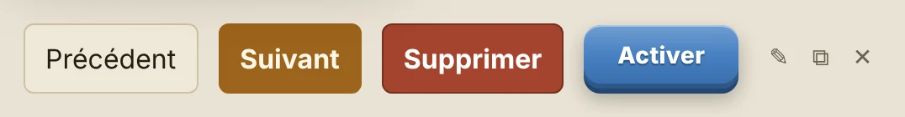

| Bouton | Classe | Quand |
|---|---|---|
| Ordinaire | `button` | action secondaire : Précédent, Retirer, Importer… |
| Principal | `button.primary` | l'action qui fait avancer : Suivant, Créer, Enregistrer. **Un seul par fenêtre.** |
| Suppression | `button.danger` | supprimer, refuser, oublier : **rouge plein** (`--red-mat`), texte blanc gras |
| Icône | `button.ico` | outils d'une carte : ✎ modifier, ⧉ dupliquer, ✕ supprimer (`.ico.danger`, rouge au survol) |
| Décision en jeu | `button.btn-action` | boutons en relief des fenêtres de réaction et de début de combat. L'action principale (Activer, Intervenir) en **bleu** avec `.primaire` ; l'autre (Laisser) en **relief neutre** gris-brun `#8d8676` |
| Rond de talent | `talentRond()` | les talents et actions de la barre et des fiches (section 7) |

Le texte d'un bouton est un **verbe court**, à l'infinitif ou à l'impératif, sans point final.

---

## 6. Cartouches et pastilles

**Cartouche d'identité** (`.hero-cartouche`) : genre, espèce. Fond `#f4ecda`, bord `#cdbf9f`, coins ronds, `system-ui` 700 13 px.
**Cartouche de classe** (`.sheet-class`) : bord et encre de la teinte de la classe, fond à 16 % de cette teinte, MAJUSCULES espacées, le niveau en minuscules.

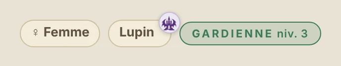

**Pastilles de bonus** (`pastilleCarac`, `pastilleComp`) : icône de la carac ou de la compétence puis la valeur, à l'encre de sa teinte. Sur deux lignes à la création : Vitesse et caracs d'abord, compétences ensuite par ordre alphabétique.

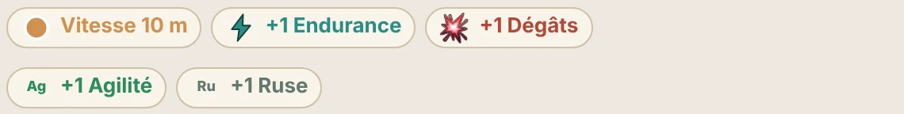

**Pastille d'Extension** (`pastilleExtension(cle)`) : un rond de 26 px **au coin haut droit** de ce qui vient d'une extension, fond très pâle de la teinte du logo, bulle « Extension : … » au survol.

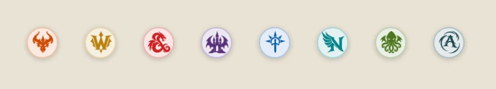

| Extension | Teinte |
|---|---|
| Diablo | `#d2500a` |
| WoW | `#b8860b` |
| D&D | `#d32f2f` |
| Ravenloft | `#5b3a8c` |
| Faërun | `#1e5fb4` |
| Nimble | `#12898a` |
| Cthulhu | `#4f7a28` |
| Amertüme | `#1f4d55` |

**Barre de PV** (`lifebar`, jauge des tokens) : les PV en vert ; à droite, chacune à sa part des PV max :

| Part | Classe | Teintes |
|---|---|---|
| Radiance | `.pv-radiance` | or brillant `#f2c14e`, reflet `#fff3c4` |
| Nécrose | `.pv-necrose` | hachures `#8fa52a` et `#bcd24a` (jaune-vert maladif, comme son icône) |
| Armure | `.pv-armure` | bleu électrique `#4fd8ff`, reflet `#b8f2ff` |

**Points d'Action et de Mouvement** (`.pt.action`, `.pt.mvt`) : toujours leur icône, `img/points/pa.webp` (bleu) et `img/points/pm.webp` (brun) ; dépensé, grisé.

**Mouvement gelé** (`.gele`) : sous Gel, les points de Mouvement prennent le bleu du Gel `#8fd3f7`, cerclé de `#2f8fae`.

**Indice de performance** (`.indice-perf`, MJ seul) : en bas à gauche, dans la couche du dessus, sur toutes les pages. Une pastille de 10 px — vert `#2f7a4b` jusqu'à 50 ms par image, orange `#c2692a` jusqu'à 150 ms, rouge `#b8352f` au-delà —, puis les images par seconde en gras et la plus longue image des deux dernières secondes ; fond `#1b1410f2`, encre `#f6e9d8`, liseré `#d29180`, comme le bandeau de version. Sa croix le cache sur l'appareil ; les Réglages le rendent.

---

## 7. Ronds de talent

Un talent se montre en **rond** : fond pâle et anneau de la teinte de son type (section 3), logo au centre, nom dessous. Tailles : grand pour les actions, moyen pour les passifs, petit pour les bonus.

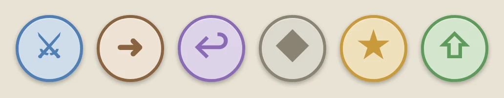

Une **action bonus** (Action gratuite) a son rond **turquoise** `#2a9d8f` dans la barre d'actions (`.t-bonus`).

Un talent indisponible est **grisé**, jamais caché. Un talent qui s'ouvre (réaction, début de combat) **rayonne** de sa teinte.

---

## 8. Fenêtres

**Fenêtre** (`dialog(id, titre, html)`) : fond `--panel`, bord `--line-strong`, coins 12 px, titre en Killam, bouton ✕ en haut à droite, boutons d'action en bas à droite, le principal à droite.

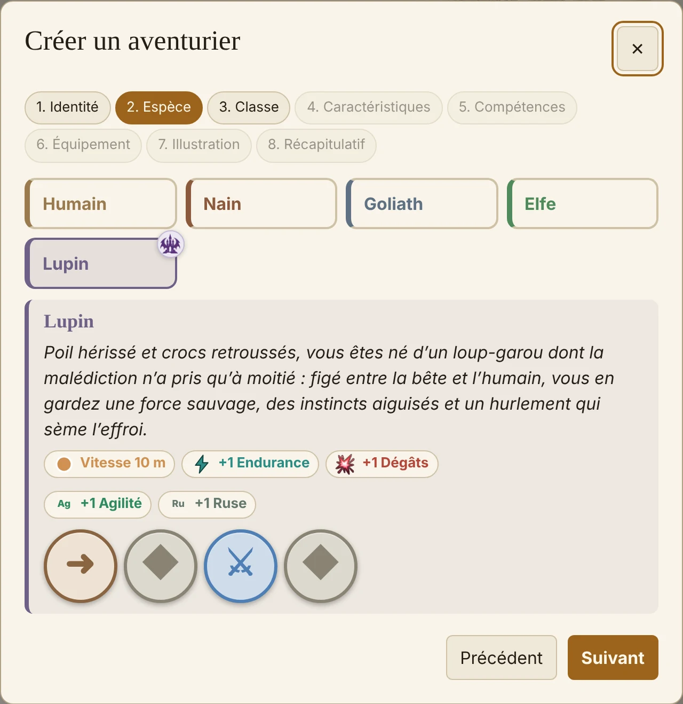

**Fenêtre de réaction et de début de combat** (`.choix-intervention`) : sur la carte, sous sa barre de boutons, côte à côte sans se couvrir. Liseré gauche violet (réaction) ou or (début de combat), titre avec le logo du talent, deux boutons `btn-action` : le principal en bleu, l'autre en relief neutre, et une barre de temps en bas pour un délai.

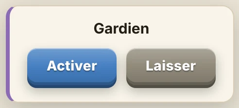

---

## 9. Panneaux et sections

Une page est faite de panneaux `.panel` (fond `--panel`, bord `--line`). Une colonne ou une section a un titre en MAJUSCULES espacées, encre `--muted`, filet dessous (`.cat-col h3`), et son compteur dans une puce à droite.

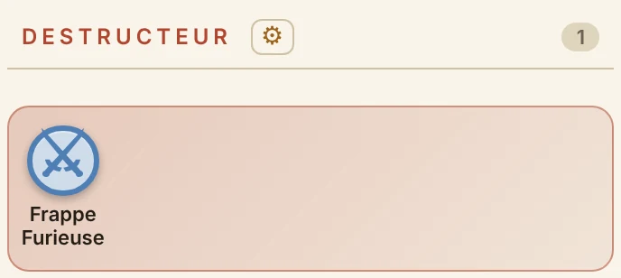

**Fiche d'aventurier** : en tête, l'avatar, le nom en Killam et les outils ; dessous, les cartouches genre, espèce et classe ; puis les caracs, les compétences, les talents et l'inventaire, chacun sous son titre de section.

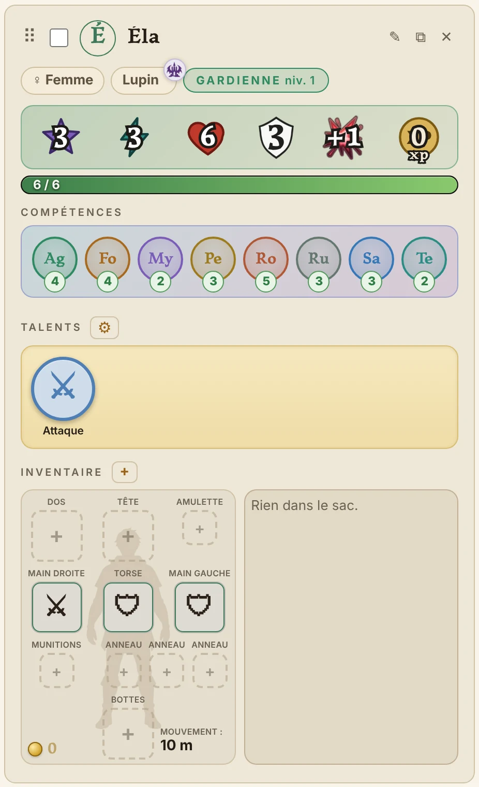

**Table plein écran** (écran de plus de 900 px, MJ et joueurs) : la carte prend toute la page sous le menu, d'un bord à l'autre et jusqu'en bas, sur un fond noir `#000`. Elle se tient dans la zone libre — entre les colonnes, sous sa barre, au-dessus de la place de la barre d'actions, à 12 px de chacune : ajustée, elle y tient entière ; zoomée, son bord vient au ras de cette zone, jamais plus loin. Sa barre (titre, outils, zoom) flotte en haut, entre les deux colonnes, panneau `--panel` à liseré `--line`. Les panneaux de la Table flottent par-dessus, rangés en colonnes, avec une ombre portée ; chacun se prend par son titre ou par la barrette qui paraît sur son bord haut au survol (`.prise-fenetre`), se pose où l'on veut et y reste sur l'appareil ; un double-clic sur sa prise le rend à sa colonne. Lâchée au-dessus d'une colonne, elle s'y range au-dessus ou au-dessous des autres, au même écart : une place en tirets `--line` s'ouvre là où elle ira. Aucun texte n'est ajouté. **Tab ⇥** cache cette interface — panneaux et barre de la carte ; la barre d'actions reste — et pose en haut de la carte, au style du bandeau de version (fond `#1b1410f2`, encre `#f6e9d8`, liseré `#d29180`), « Appuyez sur Tab ⇥ pour faire réapparaître l’interface. » ; Tab, un changement d'onglet ou de page la rendent.

---

## 10. Champs

Libellé au-dessus du champ, en `system-ui`, encre `--muted`. Champs sur fond `--field`, bord `--line`, focus en contour `--accent`. Une case à cocher a son libellé à droite (`.field-check`). Les champs se rangent en grille (`.edit-grid`).

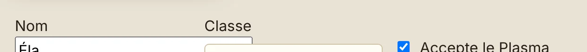

---

## 11. Journal

Une ligne par événement, en cartouche arrondi, fond et bord pâles du **ton** de l'événement. Les noms sont en gras à la couleur de leur camp, les chiffres en gras, et les dégâts s'écrivent avec l'icône des dégâts, pas avec le mot.

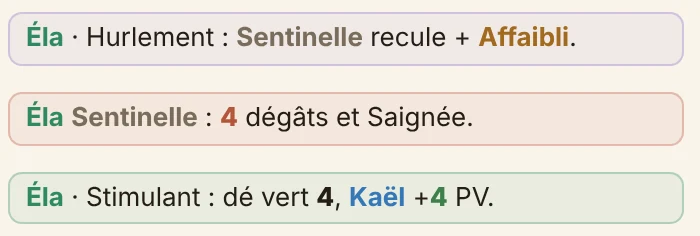

| Ton | Couleur | Pour |
|---|---|---|
| `attaque` | `#3f7bc0` | coups portés |
| `talent` | `#8a63c9` | talents joués |
| `degats` | `#b8483a` | dégâts subis |
| `soin` | `#2f8a63` | soins |
| `etat` | `#a2691f` | états |
| `competence` | `#2f7d45` | tests |
| `reveal` | `#9d7b1e` | révélations |
| `carte` | `#8a6d3b` | carte, déplacements |
| `butin` | `#a8832c` | objets trouvés |

Une information qui se voit déjà (une recharge animée, un état affiché) **ne s'écrit pas** au journal.

**Aucune nouvelle ligne de journal** sans demande expresse : une porte ou des volets qu'on ouvre se voient sur la carte, ils ne s'écrivent pas.

---

## 12. Animations

- Courtes, de 400 à 700 ms, avec une courbe douce.
- Elles montrent un mouvement réel : une bille de Plasma qui part du token vers la Cellule, une flèche, une poussée.
- L'arrivée d'une animation se marque par un **éclat** bref (agrandissement et halo de la teinte).
- Si l'appareil demande de réduire les animations (`prefers-reduced-motion`), seul l'éclat reste.

---

## 13. Contrôles automatiques

`checks.cjs` vérifie à chaque publication, et la publication échoue en cas d'écart :
- **Infobulles** : chaque `ouvrirBulle(…)` utilise une classe de bulle déjà connue (`bulle-talent`, `bulle-calcul`, `bulle-comp`, `bulle-gear`, `bulle-modele`, `bulle-test`, `bulle-detail-degats`, `bulle-fouilleur`, `bulle-joueurs`, `bulle-satellite`), et aucune nouvelle bulle n'est ouverte sans classe. Une nouvelle classe de bulle ne s'ajoute qu'avec l'accord de Valentin, dans cette charte puis dans le contrôle.
- **Couleurs** : dans `editor.css`, sous le repère « Charte graphique », toute couleur écrite en dur (`#…`) figure dans cette charte.
- **Fond des bulles** : aucun `className='talent-detail large'` nu ; une bulle porte toujours sa teinte (`t-…`, `bulle-teintee`, ou une classe de bulle dédiée).
- **Charte présente** : `CHARTE.md` et ses captures `img/charte/` existent.

Les autres règles (texte non demandé, `texteEnrichi()` pour les textes de jeu, français du site) se relisent à la main avant chaque publication.

**Repos court au journal** : « Remus effectue un **Repos Court** (vert `#2f8a63`) : **Soin 7 PV**. », puis, s'il en avait, « Il perd tous ses **états négatifs** (rouge `#b8352f`). ». Rien d'autre.

**Terrain nommé dans une bulle de pièce** (`.mot-terrain`) : le nom d'un type de terrain dangereux — « Ronces » — s'écrit en gras, de la couleur du terrain (celle de la carte ouverte d'abord, sinon de la première carte qui le définit).

**Exemplaires d'une pièce posée sur la carte** (`.quantite-bulle`) : une seule bulle par pièce ; leur nombre, s'il dépasse un, dans un rond de 26 px à cheval sur le coin supérieur droit de la bulle (fond `--panel`, liseré `--line`, chiffre gras à l'encre).

**Sélecteur d'un objet de la carte** (`.objet-liste`) : le nombre d'exemplaires choisis (×2…) en pastille en bas à droite du carré, comme dans l'inventaire ; la coche reste en haut à droite.

**Zone d'un objet lancé** (`#zone-lancer`) : la zone de contact de la taille réglée, coupée par les murs, qui suit le pointeur : voile et tirets orange `#c2692a` (voile à 18 %) ; grisée `#7d7a74` là où l'objet ne peut pas tomber.

**Bulle d'une pièce de l'Armurerie** (`.gear-detail` dans `bulle-gear`) : en tête (`.gear-tete`), l'icône de la pièce (64 px) à gauche ; le nom en Killam gras 20 px et, dessous, sa sorte en italique `--muted` (sous-type d'une potion, sorte d'arme, emplacement d'une armure…) ; la valeur en haut à droite, chiffre en Killam doré `#a0761a` 20 px et pièce d'or ; texte du corps en 14 px. Le nom (sauf au-delà de 28 caractères) et la sorte tiennent chacun sur une ligne : la bulle s'élargit jusqu'à 480 px. Un trait fin (`.gear-trait`), puis le reste — dés, défense, bonus, notes. Fond et liseré gauche restent ceux de la rareté.

**Bulle d'un talent** (`.talent-detail` dans `bulle-talent`) : comme celle d'une pièce. En tête (`.talent-tete`), l'icône du talent (56 px) à gauche ; le nom en Killam gras 20 px (son coût en PA/PM juste devant, son palier en chiffre romain derrière) et, dessous, sa nature et son déclencheur en italique `--muted` (« Action · Début de combat », « Passif · À 50% des PV »… ; une limite déjà prise en rouge `#b03a48`) ; à droite, à la place de l'or, ses dés et les états qu'il porte. Un trait fin (`.talent-trait`), puis le texte du talent, comme avant. Fond et liseré gauche : la teinte de sa nature. Un bonus de caractéristique garde sa bulle.

**Texte d'une pièce** (Notes) : chaque retour à la ligne ouvre une ligne ; une ligne qui commence par « - », « • » ou « * » devient une puce (`.gear-puce`), au losange des affixes.

**Code d'un coffre** (`#code-coffre`) : la fenêtre ordinaire, titrée « Code » ou « Mot de passe » ; un code se saisit en autant de cases que de chiffres (`.code-cases`, chiffres gras à chasse fixe, le curseur passe seul à la suivante) ; un mot de passe, sur une ligne ; un seul bouton plein, « Ouvrir ».

**Recette** (catégorie `recette`, colonne « Recettes » de l'Armurerie) : nommée « Recette : <pièce> », de la couleur de rareté de la pièce qu'elle fabrique ; son icône est celle des recettes de son métier (Herboristerie, Tannerie, Forge), choisie dans les icônes communes, section « Recettes » ; à défaut 📜. Sa sorte, sous le nom : « Recette d'herboristerie », « de tannerie », « de forge ».

**Réordonner les cartes et les lieux** (éditeur de cartes) : une carte glissée sur une autre se pose juste avant elle, dans son lieu ; un bandeau de lieu glissé sur un autre passe juste avant lui. Là où ça se posera, un trait `--line-strong` au-dessus.
